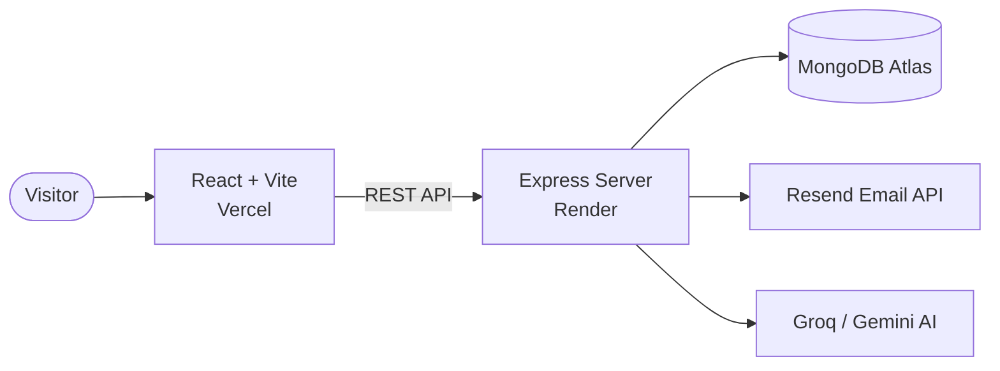

 

  

 

  A modern, responsive developer portfolio with an interactive AI assistant and a contact form that delivers messages straight to my inbox.

---

##  Preview

<!-- Add your own screenshots to the assets/ folder with these names -->

  

<table>
  <tr>
    <td align="center"> <b>Projects</b></td>
    <td align="center"> <b>Contact</b></td>
  </tr>
  <tr>
    <td align="center"> <b>AI Assistant</b></td>
    <td align="center"> <b>Light Mode</b></td>
  </tr>
</table>

---

##  Features

<table>
  <tr>
    <td width="50%" valign="top">
      <h3> AI Chatbot</h3>
      An assistant that answers questions about my skills, projects and experience, powered by Groq and Google Gemini.
    </td>
    <td width="50%" valign="top">
      <h3> Smart Contact Form</h3>
      Validated submissions are saved to MongoDB and delivered to my inbox as a clean, branded email through Resend, with a one-click reply button.
    </td>
  </tr>
  <tr>
    <td width="50%" valign="top">
      <h3> Dark &amp; Light Mode</h3>
      A theme switcher with a polished dark-first design, so the site looks good at any time of day.
    </td>
    <td width="50%" valign="top">
      <h3> Fully Responsive</h3>
      A sidebar layout that adapts smoothly from large desktops down to phones.
    </td>
  </tr>
  <tr>
    <td width="50%" valign="top">
      <h3> Project Showcase</h3>
      Selected work with tech stacks, live demos and source links in one place.
    </td>
    <td width="50%" valign="top">
      <h3> Fast &amp; Automated</h3>
      Built with Vite for quick loads, with automatic deployments on every push to <code>main</code>.
    </td>
  </tr>
</table>

---

##  Tech Stack

| Layer | Technologies |
| :-- | :-- |
| **Frontend** | React, Vite, JavaScript, CSS |
| **Backend** | Node.js, Express 5, REST API |
| **Database** | MongoDB Atlas, Mongoose |
| **Email** | Resend API |
| **AI** | Groq SDK, Google Generative AI |
| **Hosting** | Vercel (frontend), Render (backend) |

---

##  Architecture

---

##  Let's Connect

 

⭐ If you like this project, consider giving it a star!

